<p align="center">
  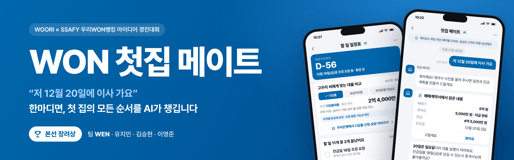
</p>

<p align="center">
  
  
  
  
</p>

<p align="center">
  <b>생애 첫 집을 사는 고객이 계약서를 올린 날부터 잔금일 송금까지,<br>
  우리WON뱅킹 안에서 모든 순서를 챙겨 주는 AI 에이전트 서비스 제안</b>
</p>

<p align="center">
  <a href="https://dldudwnsdlek.github.io/woori_first/presentation/"><b>▶ 발표자료 보기</b></a>
  &nbsp;·&nbsp;
  <a href="presentation/won-first-home-mate_final.pdf"><b>📄 PDF</b></a>
  &nbsp;·&nbsp;
  <a href="docs/qna.md"><b>💬 예상 질문과 답변</b></a>
</p>

<br>

| | |
|---|---|
| **대회** | WOORI × SSAFY 우리WON뱅킹 아이디어 경진대회 |
| **주제** | 우리WON뱅킹 신규 서비스 제안 · AI 에이전트 |
| **결과** | 🏆 **본선 장려상** (2026.11.19) |
| **팀** | WEN — 유지민 · 김승현 · 이영준 |
| **결과물** | 서비스 기획, 앱 화면 컨셉 프로토타입, 13장 웹 발표자료 |

<br>

## 문제 — 집은 찾았는데, 무엇부터 해야 할까요?

생애 첫 집 매매는 고객이 평생 하는 가장 큰 금융 거래입니다. 그런데 계약서에 도장을 찍은 뒤 잔금일까지 약 두 달 동안, 대출 · 서류 · 보증금 · 송금을 고객이 혼자 챙겨야 합니다. 막힐 때마다 은행, 중개사, 법무사를 따로 찾아가야 합니다.

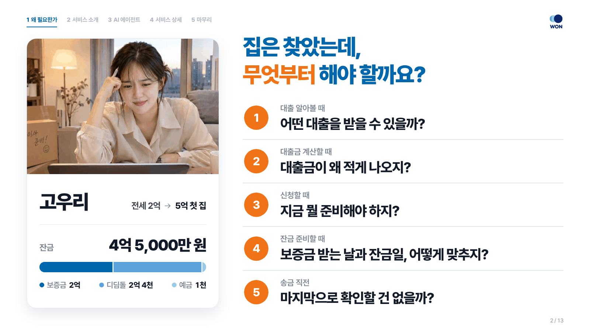

**페르소나 고우리 씨** — 전세 2억 원 집에 살다가 5억 원짜리 첫 집을 계약했습니다. 잔금 4억 5,000만 원은 전세 보증금 2억 + 디딤돌대출 2억 4,000만 + 예금 1,000만으로 맞출 계획입니다.

| 막힘 | 시점 | 고객의 질문 |
|:---:|---|---|
| ① | 대출 알아볼 때 | 어떤 대출을 받을 수 있을까? |
| ② | 대출금 계산할 때 | 대출금이 왜 적게 나오지? |
| ③ | 신청할 때 | 지금 뭘 준비해야 하지? |
| ④ | 잔금 준비할 때 | 보증금 받는 날과 잔금일, 어떻게 맞추지? |
| ⑤ | 송금 직전 | 마지막으로 확인할 건 없을까? |

## 해결 — WON 첫집 메이트

"저 12월 20일에 이사 가요" 한마디와 계약서 사진 한 장으로, 잔금일까지의 계획을 세우고 우리은행의 실제 계좌 · 대출 기능으로 다음 행동을 연결합니다.

| | 기능 | 하는 일 |
|:---:|---|---|
| 💰 | **맞춤 대출 설계** | 정책자금부터 대안 상품까지 비교하고 추천 |
| 📑 | **서류 · 심사 관리** | 상품별 서류 일정을 잡고 심사 진행을 알림 |
| 🔍 | **계약 위험 점검** | 권리관계 · 반환보증 확인 |
| ✅ | **잔금일 안심 실행** | 자금 조율, 송금 전 최종 확인, 고객 승인 이체 |

## 앱 화면

고우리 씨가 계약서를 올린 10월 23일부터 잔금일 12월 18일까지를 네 장면으로 따라갑니다.

<table>
  <tr>
    <td align="center" width="25%">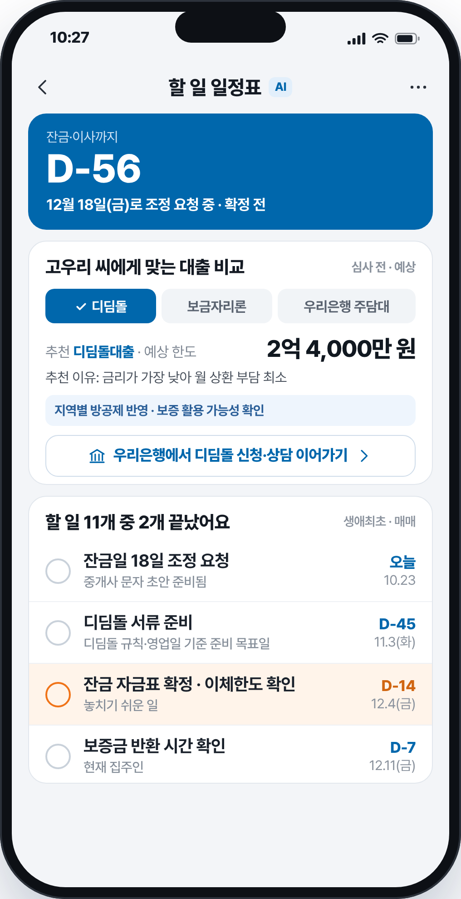</td>
    <td align="center" width="25%">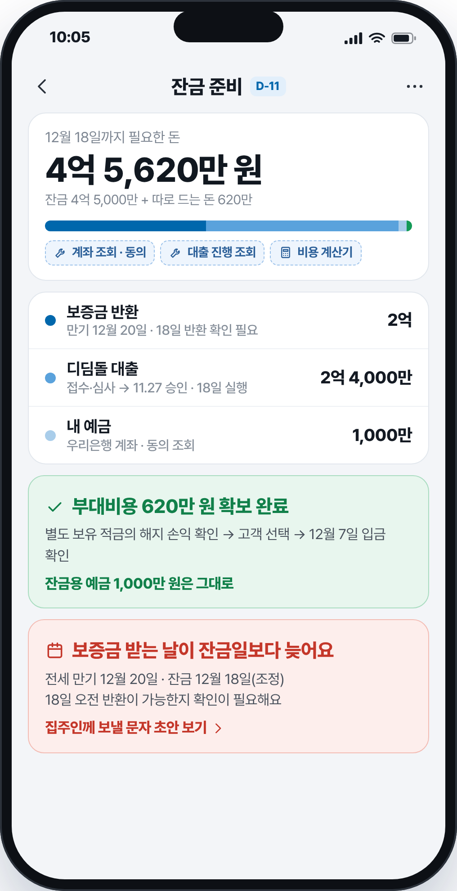</td>
    <td align="center" width="25%">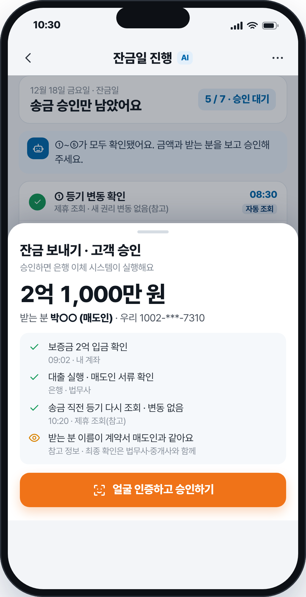</td>
    <td align="center" width="25%">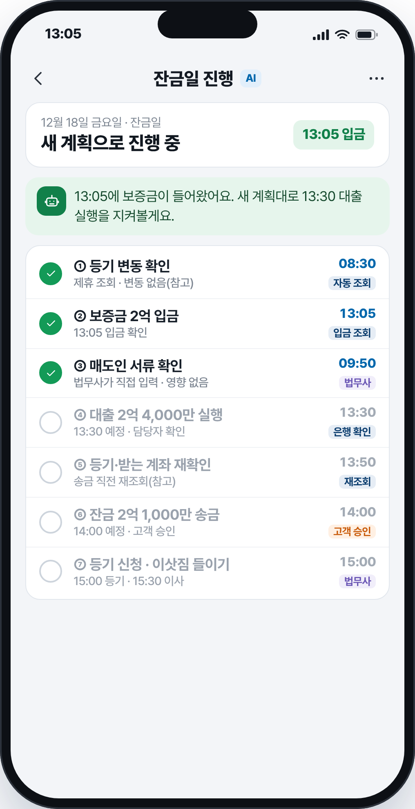</td>
  </tr>
  <tr>
    <td align="center"><b>① 계약서로 계획 세우기</b><br><sub>10월 23일 · D-56</sub></td>
    <td align="center"><b>② 모자란 돈 · 어긋난 날짜</b><br><sub>11월 27일 ~ 12월 7일</sub></td>
    <td align="center"><b>③ 잔금일 진행 · 송금 승인</b><br><sub>12월 18일 오전</sub></td>
    <td align="center"><b>④ 보증금 지연 → 재계획</b><br><sub>12월 18일 09:40</sub></td>
  </tr>
</table>

<details>
<summary><b>장면별 자세히 보기</b></summary>
<br>

**① 계약서를 읽고 대출 · 일정 세우기** (막힘 ①②③)
- 계약서에서 매매가 · 계약금 · 잔금 · 잔금일을 읽고, 고객이 '맞아요'를 눌러야 계획에 반영합니다.
- 잔금일 12월 20일이 **일요일**이라 대출 실행 · 등기 신청이 어렵다는 것을 영업일 달력으로 먼저 찾고, 18일(금)로 당기는 중개사 문자 초안을 만듭니다.
- 디딤돌 · 보금자리론 · 우리은행 주담대를 비교해 디딤돌을 추천(예상 한도 2억 4,000만 원)하고, 상품 일정에 맞춰 할 일 11개를 만듭니다.

**② 승인 알림, 모자란 돈과 어긋난 날짜** (막힘 ③④)
- 디딤돌 승인 후 잔금일까지 필요한 돈을 계산합니다: 잔금 4억 5,000만 + 부대비용 620만 = **4억 5,620만 원**.
- 취득세 · 중개보수 · 등기비용 620만 원을 2주 전에 찾아, 별도 적금 해지 손익을 보여 주고 고객이 고르게 합니다.
- 잔금일을 당기면서 생긴 충돌(전세 만기 20일 vs 잔금 18일)을 매매계약서와 전세계약서를 함께 보고 찾아냅니다.

**③ 잔금일 진행 상태와 고객 승인** (막힘 ⑤)
- 등기 변동 확인 → 보증금 입금 → 매도인 서류 확인 → 대출 실행 → 등기 · 받는 계좌 재확인 → **잔금 송금(고객 승인)** → 소유권 이전 등기, 7단계를 한 화면에 보여 줍니다.
- 끝났는지는 은행 시스템과 담당자 입력으로만 확인합니다. **"AI가 짐작해 초록으로 바꾸지 않습니다."**
- 송금은 고객이 금액과 받는 분을 보고 본인 인증으로 승인하면 은행 이체 시스템이 실행합니다.

**④ 예외: 보증금 지연 → 남은 계획 다시 짜기** (막힘 ⑤)
- 예정 시간에 보증금이 들어오지 않자 입금 조회로 먼저 알아채고 알립니다.
- 끝난 일은 그대로 두고, 영향받는 일(대출 실행 · 송금 · 등기 · 이사)만 골라 다시 짭니다.
- 집주인 · 중개사 문자 초안과 상담 연결을 준비하고, 회신을 반영한 새 시간표를 고객이 확정합니다.

</details>

## AI 에이전트 — 상황이 바뀌면 계획도 바뀐다

고객의 목표는 하나입니다. "12월 20일까지 잔금과 입주 준비를 마치고 싶어요." 메이트는 정해진 체크리스트를 보여 주는 데서 멈추지 않고, 이 목표를 향해 **계획 → 확인 → 재계획 → 승인**을 반복합니다. 상태가 바뀔 때마다 다시 확인하고 계획을 고칩니다.

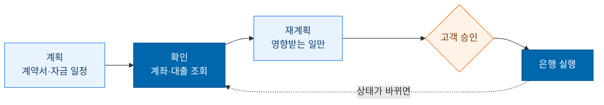

돈이 걸린 서비스라서, 누가 무엇을 하는지를 화면마다 태그로 구분했습니다.

| 주체 | 맡는 일 | 예시 |
|---|---|---|
| 🤖 **AI** | 해석 · 제안 · 재계획 · 초안 | 계약서 읽기, 일요일 잔금일 찾기, 대출 비교 설명, 연락 문자 초안 |
| 🏦 **은행 시스템 · 도구** | 조회 · 계산 · 실행 | 영업일 달력, 한도 · 비용 계산, 입금 · 대출 조회(동의), 이체 실행 |
| 🙋 **고객** | 확인 · 승인 | 읽은 값 확인, 문자 발송 결정, 새 시간표 확정, 송금 승인 |
| 👩‍⚖️ **전문가** | 판단 | 법무사의 서류 · 권리관계 확인, 담당자의 대출 실행 판단 |

## 잔금일 돈의 흐름

잔금 4억 5,000만 원이 잔금일 하루 동안 어떻게 움직이는지 정리한 백업 슬라이드입니다. 대출금은 매도인에게 바로 가고, 고객이 승인해 보내는 돈은 2억 1,000만 원입니다.

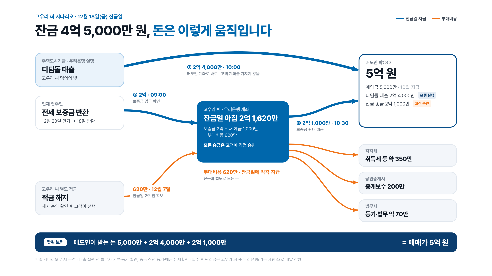

## 우리은행의 기회

인생에서 가장 큰 거래를 도우면, 가장 큰 돈이 우리은행으로 옵니다.

<table>
  <tr>
    <td align="center" width="33%">
      <sub>① 고객이 찾아옵니다</sub>
      <h3>67%</h3>
      복잡한 금융 업무에<br>AI 에이전트를 쓸 의향<br>
      <sub>CJ메조미디어 업종 리포트 (2026.10)</sub>
    </td>
    <td align="center" width="33%">
      <sub>② 큰 돈이 움직입니다</sub>
      <h3>2.17억 원</h3>
      1인당 새로 받은<br>은행 주택담보대출<br>
      <sub>한국은행 차주별 가계부채 통계 (2026년 2분기)</sub>
    </td>
    <td align="center" width="33%">
      <sub>③ 은행에 남습니다</sub>
      <h3>74.3%</h3>
      대출이 카드 · 급여이체 등<br>추가 거래로 이어진 고객<br>
      <sub>IBK기업은행 개인금융 인사이트 (2026.3)</sub>
    </td>
  </tr>
</table>

- 한 해 전국 주택 매매는 **72.6만 호**(2025년, 한국부동산원 · KB주택시장 리뷰)입니다.
- 디딤돌대출의 재원인 주택도시기금의 간사 수탁은행이 우리은행입니다(2023.4~2028.3).
- 잔금 준비를 도운 경험을 입주 후 자동이체(대출 원리금 · 관리비 · 공과금)로 이어, **대출 한 건이 아니라 고객의 주거래**를 얻습니다.

## 구현 로드맵

송금 없이 시작해 단계적으로 넓힙니다. 전세지킴이 · 예약이체 같은 기존 우리은행 기능을 재사용합니다.

| 단계 | 범위 | 시작 조건 |
|---|---|---|
| **1단계** 일정 · 자금 계획 | 계약서 분석, 대출 비교 · 자금 계획 | 계좌 조회, 송금 없이 시작 |
| **2단계** 대출 진행 연결 | 대출 신청 · 서류, 심사 상태 연결 | 고객 동의 후 조회 기능 연결 |
| **3단계** 잔금 이체 연결 | 계좌 입금 · 대출 실행, 고객 승인 이체 | 내부 검토와 시범 운영 후 확대 |

## 발표 자료

13장 · 약 10분 · 2인 발표. 한 고객의 한마디 "저 12월 20일에 이사 가요"를 표지부터 마지막 장까지 따라가고, 정상 흐름과 예외 흐름(보증금 지연)을 함께 시연했습니다.

- **[발표자료 보기](https://dldudwnsdlek.github.io/woori_first/presentation/)** — 웹 슬라이드, `←` `→` 키로 넘기고 `F`로 전체 화면
- **[PDF 인쇄본](presentation/won-first-home-mate_final.pdf)** — 13쪽
- **[예상 질문과 답변](docs/qna.md)** — 사업성 · 차별화 · 구현 · AI 기술 · 규제 질문 25개와 사실 검증표

<details>
<summary><b>슬라이드 13장 펼쳐 보기</b></summary>
<br>

<table>
  <tr>
    <td width="33%">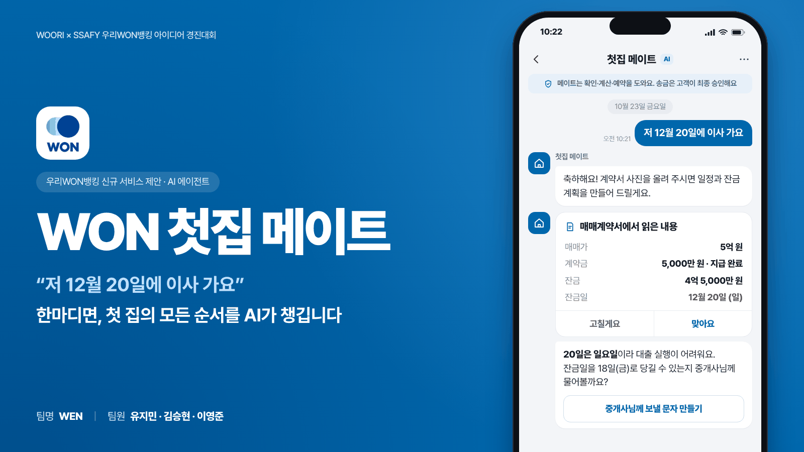<br><sub>1. 표지 — WON 첫집 메이트</sub></td>
    <td width="33%"><br><sub>2. 고우리 씨의 첫 집, 다섯 번의 막힘</sub></td>
    <td width="33%">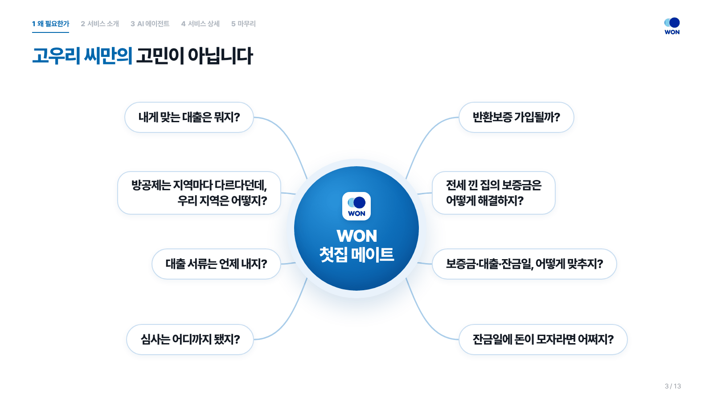<br><sub>3. 고객이 실제로 묻는 질문들</sub></td>
  </tr>
  <tr>
    <td>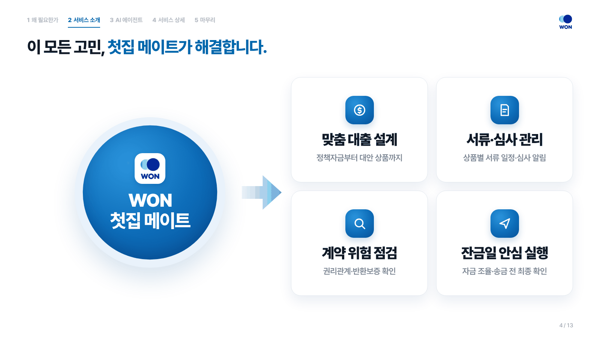<br><sub>4. 이 모든 고민, 첫집 메이트가 해결합니다</sub></td>
    <td>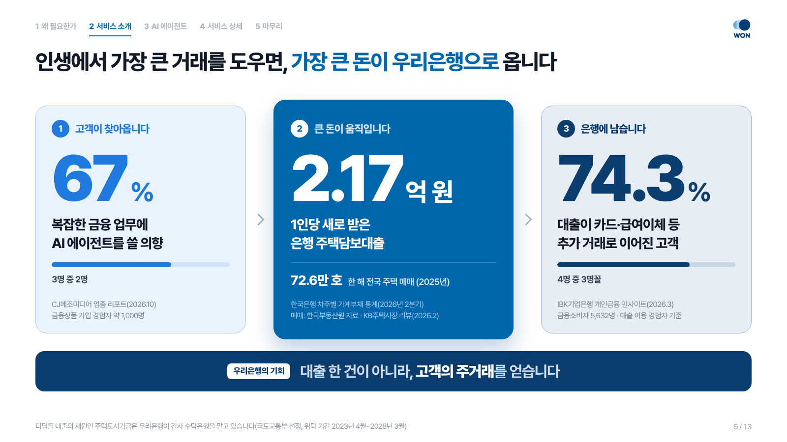<br><sub>5. 우리은행의 기회</sub></td>
    <td>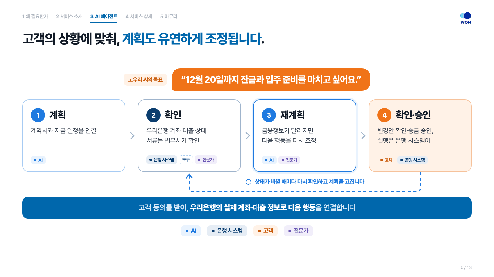<br><sub>6. AI 에이전트 — 상황이 바뀌면 계획도 바뀐다</sub></td>
  </tr>
  <tr>
    <td>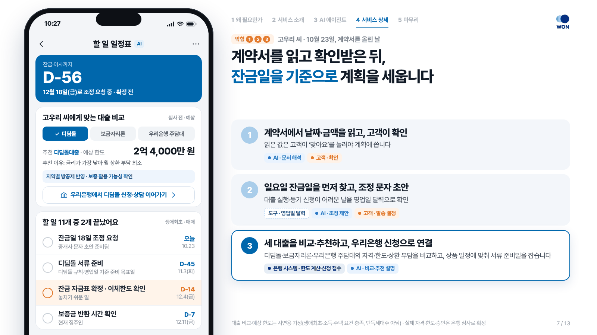<br><sub>7. 화면① 계약서를 읽고 대출·일정 세우기</sub></td>
    <td>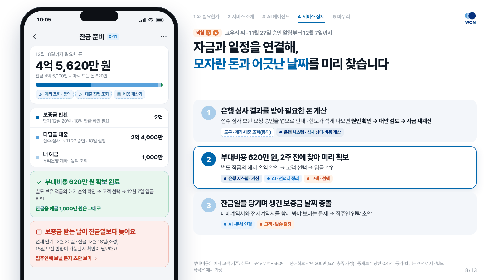<br><sub>8. 화면② 모자란 돈과 어긋난 날짜</sub></td>
    <td>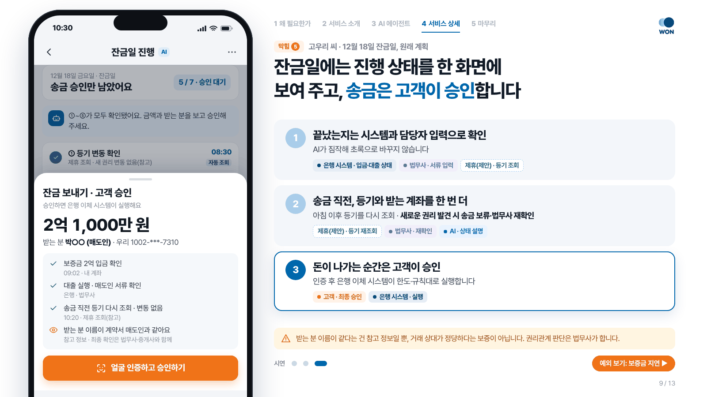<br><sub>9. 화면③ 잔금일 진행 상태와 고객 승인</sub></td>
  </tr>
  <tr>
    <td>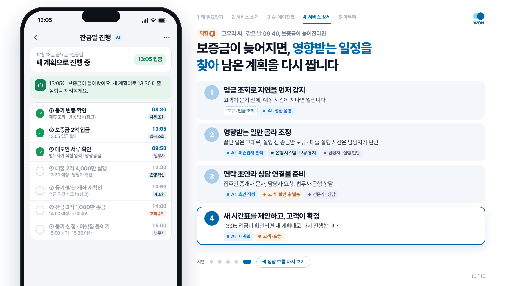<br><sub>10. 화면④ 보증금 지연 → 재계획</sub></td>
    <td>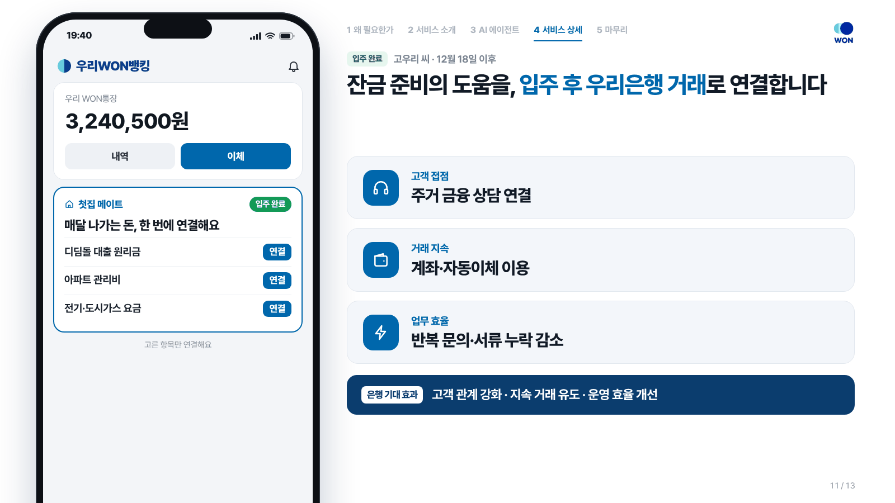<br><sub>11. 입주 후 연결과 사업 효과</sub></td>
    <td>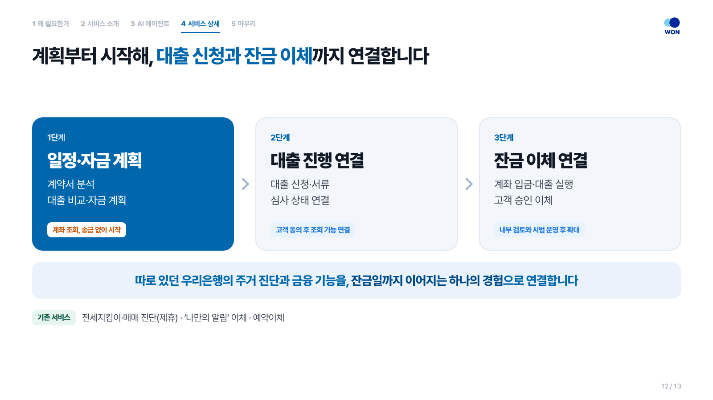<br><sub>12. 구현 — 계획에서 실행 연계까지 3단계</sub></td>
  </tr>
  <tr>
    <td>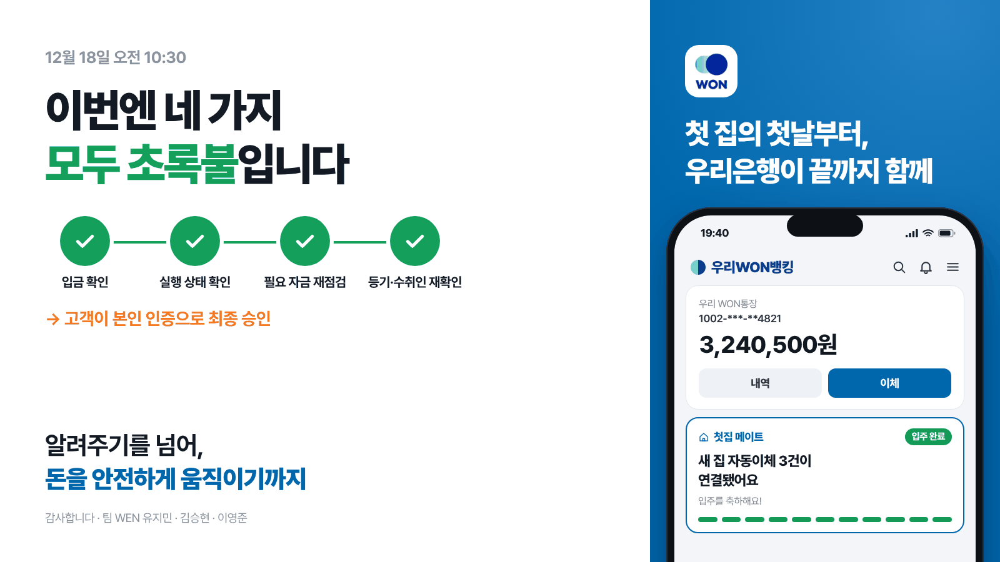<br><sub>13. 마무리 — 잔금일 오전 10시 30분, 다시</sub></td>
    <td></td>
    <td></td>
  </tr>
</table>

</details>

## 레포 구성

```
.
├── presentation/
│   ├── index.html                        # 본선 발표자료 (웹 슬라이드 13장)
│   ├── won-first-home-mate_final.pdf     # 인쇄본 PDF
│   └── appendix/                         # 백업 슬라이드
├── docs/
│   └── qna.md                            # 예상 질문과 답변 · 사실 검증
└── assets/                               # README 이미지 (배너 · 앱 화면 · 슬라이드)
```

## 팀

**팀 WEN** — 유지민 · 김승현 · 이영준

<br>

> [!NOTE]
> 앱 화면은 클릭으로 흐름을 보여 주는 **컨셉 프로토타입**이며, 실제 은행 시스템과 연결되어 있지 않습니다. 금액과 일정은 2026년 달력과 제도 기준에 맞춘 **예시**입니다. 우리은행 · 우리WON뱅킹 등의 명칭은 해당 기관의 것이며, 이 프로젝트는 경진대회 출품작입니다.
