# 첫집 메이트 발표자료 수정 가이드

WOORI × SSAFY 우리WON뱅킹 아이디어 경진대회 본선(2026.11.19) · 팀 WEN · 2026.11.12 작성 
기준 파일: 업로드한 HTML 발표자료 13장 (`web/WON첫집메이트_발표_원본.html`)

> **수정 시안**: `web/WON첫집메이트_발표_수정시안.html`
> 이 가이드의 수정안을 실제로 반영해 본 파일입니다. 키보드 조작, 대본(N), 타이머 같은 기존 기능은 그대로입니다. 문구와 수치는 팀에서 확정하면 됩니다.

---

## 0. 한눈에 보기

**전체 방향.** 덱 전체를 한 줄기로 묶습니다. "부동산 매매는 고객에게 부담스럽고, 복잡하고, 지치고, 정신없다. 첫집 메이트는 AI와 함께 그 짐을 덜어 준다." 흐름은 고객의 문제(2~4장) → 은행의 기회(5장) → 해결과 화면(6~11장) → 실현과 AI의 역할(12~13장) → 마무리(14장)입니다.

| # | 요청 | 대상 (기존 → 새 번호) | 수정 요약 |
|---|---|---|---|
| 1 | '순서대로' 표현 | 3 → 3 | "순서대로" → "하루에 맞물려". 순서 화살표·진행 막대를 빼고 "이 고객의 예시" 라벨 추가 |
| 2 | 전세사기 근거 교체 | 4 → 4 | 부담(계약금 5,000만 원) · 처음(11.5년) · 도움(AI 에이전트 이용 의향 67%) + 지불 의향 문장 |
| 3 | 은행 이익 슬라이드 | 신규 5 | 유치 38% → 전환 15% → 정착 11.5년 → 수익 4.5억 |
| 4 | KB → K사 | 5 → 6 | 행 이름·각주·대본에서 'KB부동산 전세안심 Check' 제거 |
| 5 | AI 에이전트 역할 강조 | 7·8·9·10 + 신규 13 | 동사 5개(읽고·계획하고·찾아내고·지켜보고·대신 준비합니다)와 불러 쓰는 은행 기능, 한 줄 역할 문장 |
| 6 | 폰 목업 확대 | 1·8·9·13 → 1·9·10·14 | 560px → 800px, 아래로 흘려 자르기. 표지 720 → 860px, 클로징 440 → 600px |
| 7 | 8·9장 재구성 | 8·9 → 9·10 | 한 장에 강조 한 곳. 9장은 '이체한도', 10장은 '620만 원' |
| 8 | 12장 삭제·대체 | 12 → 13 | '끝까지 함께'를 지우고 AI 에이전트 슬라이드로 대체 |
| 9 | 전체 메시지 | 전 장 | 1·2·3·4·9·10·13·14장 문구에 '부담을 덜어 준다'를 일관되게 |

---

## 1. 새 구성과 10분 시간표

13장(9분 50초) → 14장(9분 25초). 장이 하나 늘어도 10분 안에 들어오도록 대본을 줄였습니다.

| 새 | 기존 | 핵심 문장 | 발표 | 시간 | 변경 |
|---|---|---|---|---|---|
| 1 | 1 | WON 첫집 메이트 | A | 0:20 | 문구·폰 크기 |
| 2 | 2 | 잔금일 오전 10시 30분 | A | 0:30 | 부제 추가 |
| 3 | 3 | 다섯 사람의 돈이, 하루에 맞물려 움직입니다 | A | 0:40 | 수정 1 |
| 4 | 4 | 실수하면 큰일이라, 고객은 믿고 맡길 도움을 원합니다 | A | 0:45 | 전면 교체 (수정 2) |
| 5 | – | 은행에게 첫 집은, 주거래가 바뀌는 드문 순간입니다 | A | 0:45 | 신규 (수정 3) |
| 6 | 5 | 알려주는 것을 넘어 안전한 실행까지 돕습니다 | B | 0:30 | K사 (수정 4) |
| 7 | 6 | 한마디면, AI가 네 단계로 나눠 챙깁니다 | B | 0:40 | 문구 |
| 8 | 7 | AI는 돈을 직접 움직이지 않습니다 | B | 0:40 | AI 칸 문구 |
| 9 | 8 | 계약서 한 장이면, 잔금일까지 할 일 11개가 정리됩니다 | B | 0:50 | 재구성 (수정 6·7) |
| 10 | 9 | 2주 전에, 모자란 620만 원을 먼저 알려 줍니다 | C | 0:45 | 재구성 (수정 6·7) |
| 11 | 10 | 5개 조건이 모두 초록일 때만 송금이 열립니다 | C | 1:15 | 각주만 |
| 12 | 11 | 기존 서비스 위에 더해집니다 | C | 0:35 | 대본 단축 |
| 13 | 12 | 챙기는 일은 AI 에이전트가, 고객은 확인하고 승인합니다 | C | 0:45 | 신규 (수정 5·8) |
| 14 | 13 | 이번엔 다섯 개 모두 초록불입니다 | A | 0:25 | 문구·폰 크기 |

- 발표자별: A 3:25 · B 2:40 · C 3:20 (기존 A 2:50 · B 3:25 · C 3:35). A가 은행 슬라이드까지 맡고 "이 순간을 어떻게 잡을지, B가 이어가겠습니다"로 넘깁니다.
- 상단 탭: `01 문제상황` → `01 문제와 기회`. 은행 슬라이드가 1장 묶음에 들어가기 때문입니다. 나머지 탭은 그대로입니다.
- 리허설 기준: 5장을 마쳤을 때 3:00, 11장을 마쳤을 때 7:40 안팎이면 정상 페이스입니다.

<figure>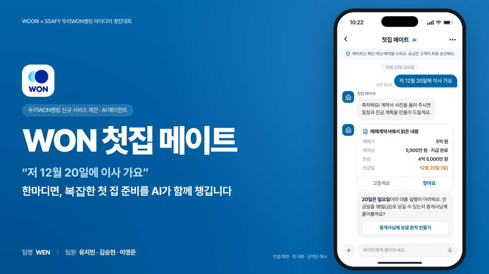<figcaption><b>1</b> 표지</figcaption></figure>
<figure>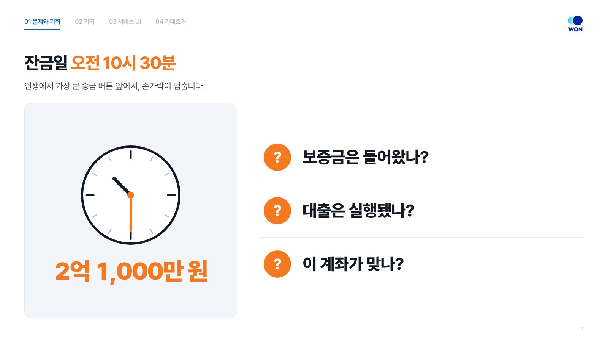<figcaption><b>2</b> 잔금일 10시 30분</figcaption></figure>
<figure>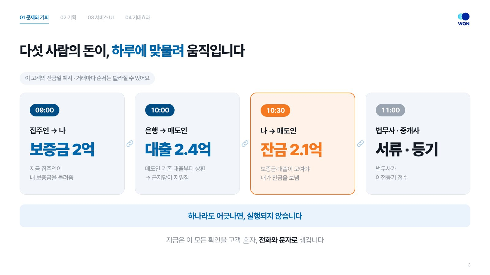<figcaption><b>3</b> 맞물리는 돈</figcaption></figure>
<figure>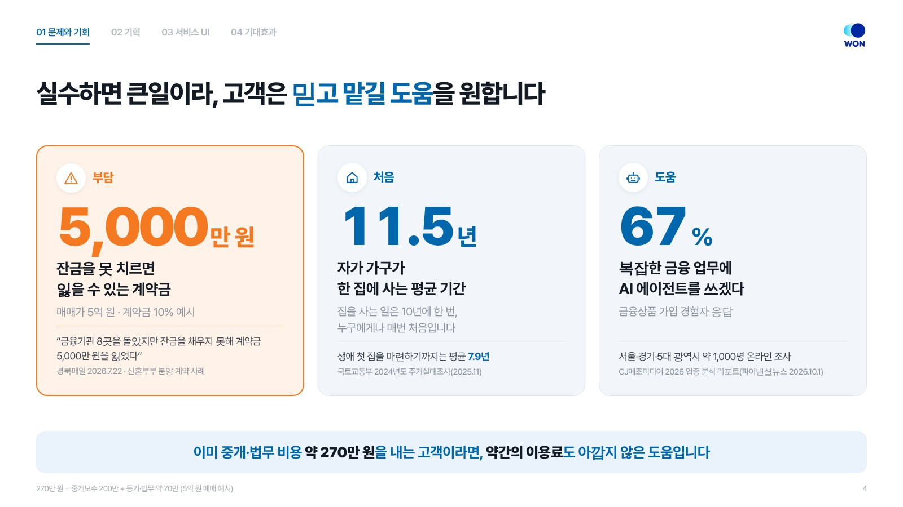<figcaption><b>4</b> 고객에게 왜 필요한가</figcaption></figure>
<figure>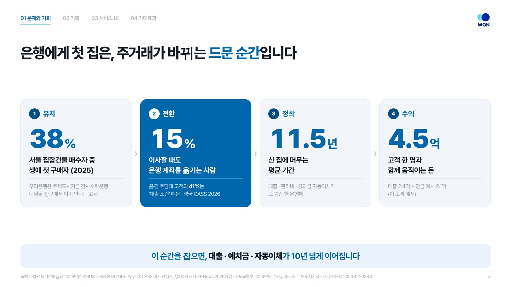<figcaption><b>5</b> 은행에게 주는 기회 · 신규</figcaption></figure>
<figure>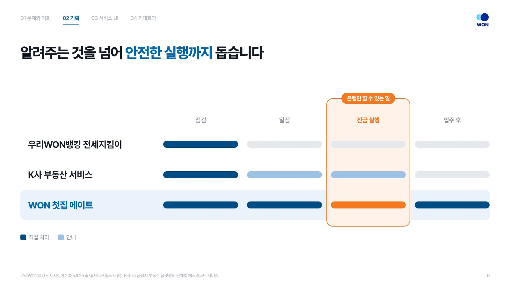<figcaption><b>6</b> 기존 서비스 비교</figcaption></figure>
<figure>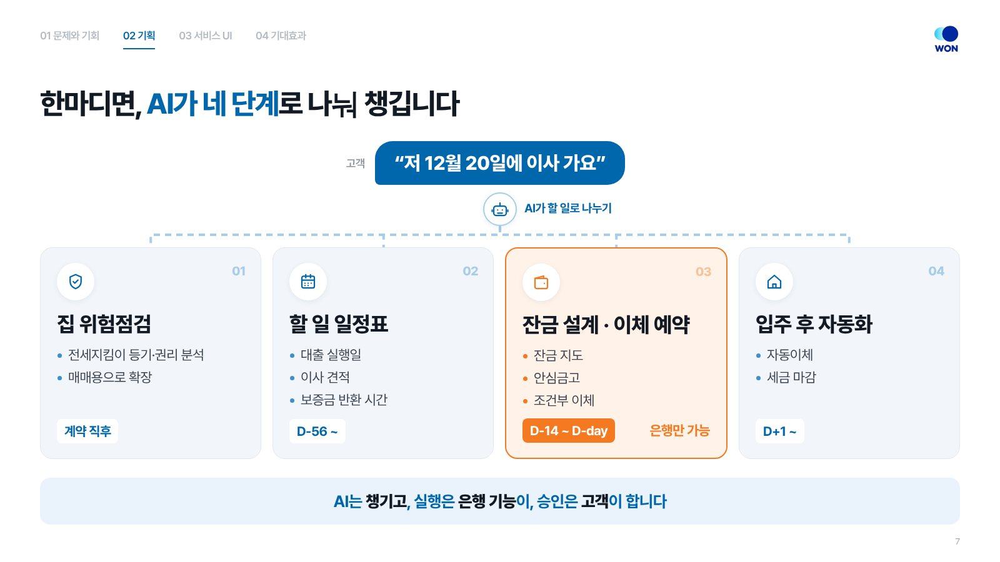<figcaption><b>7</b> 네 단계</figcaption></figure>
<figure>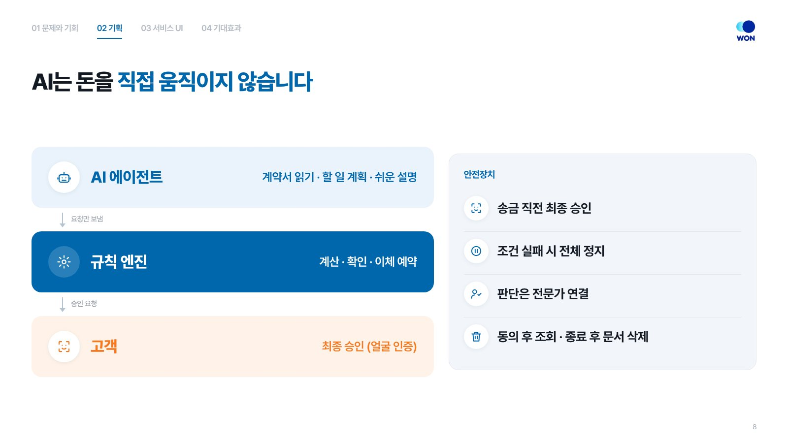<figcaption><b>8</b> AI 세 층 구조</figcaption></figure>
<figure>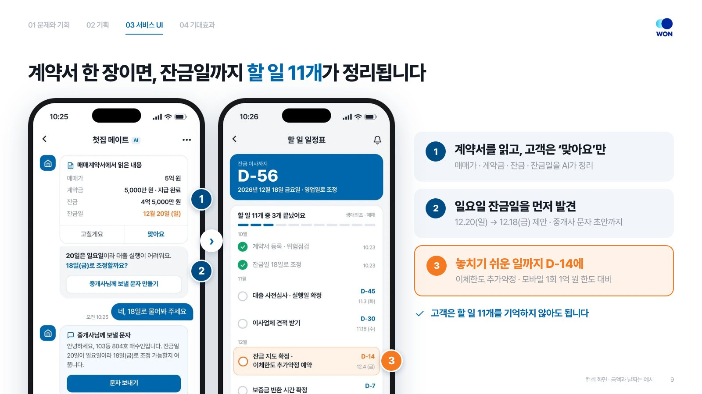<figcaption><b>9</b> D-56 일정표</figcaption></figure>
<figure>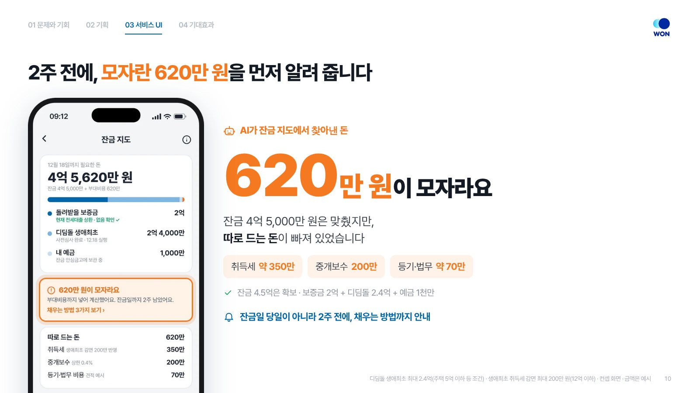<figcaption><b>10</b> D-14 잔금 지도</figcaption></figure>
<figure>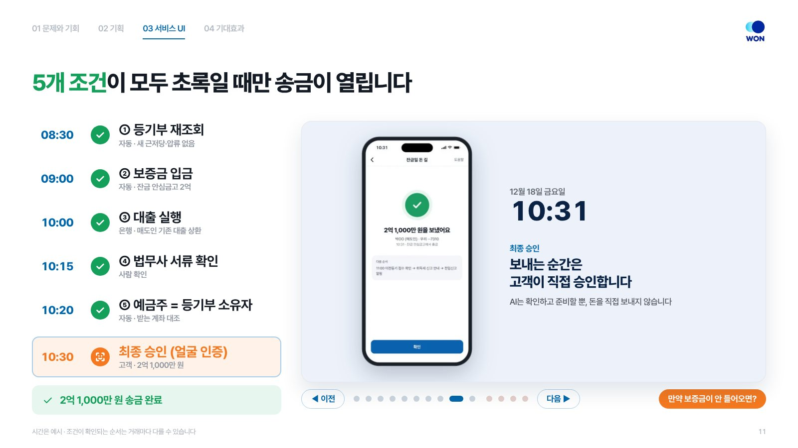<figcaption><b>11</b> 잔금일 돈 길</figcaption></figure>
<figure>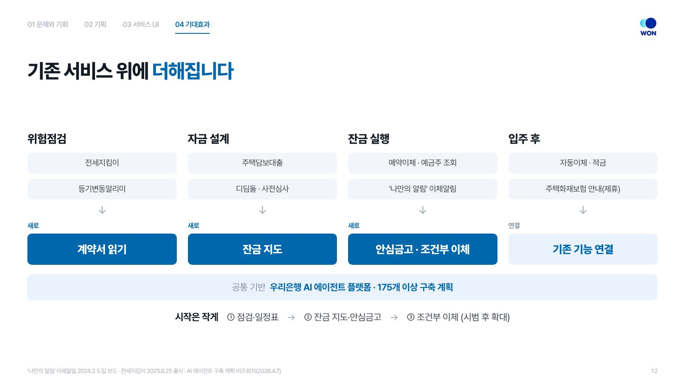<figcaption><b>12</b> 기존 서비스 위에</figcaption></figure>
<figure>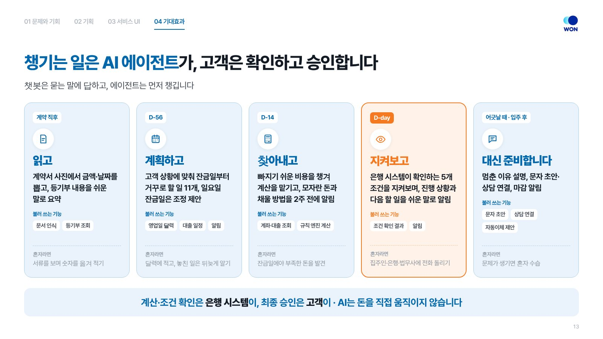<figcaption><b>13</b> AI 에이전트가 하는 일 · 신규</figcaption></figure>
<figure>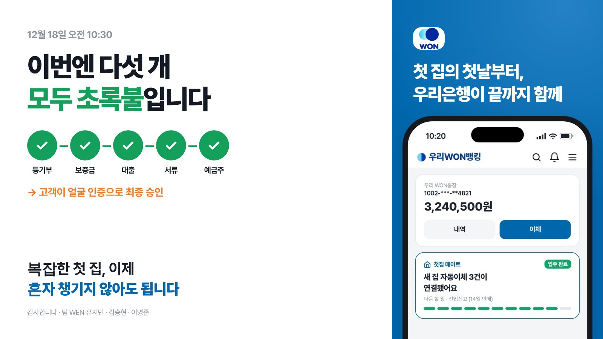<figcaption><b>14</b> 클로징</figcaption></figure>

---

## 2. 항목별 수정안

### 수정 1 · 3장 "순서대로" → "맞물려"

**왜 바꾸나.** "다섯 사람의 돈이, 순서대로 움직입니다"는 모든 거래가 같은 순서로 진행된다는 주장으로 읽힙니다. 실제로는 거래마다 다릅니다. 법무사가 매도인 서류를 먼저 확인한 뒤 대출이 실행되기도 하고, 보증금이 오후에 들어오기도 하며, 세입자를 승계하는 거래에는 보증금 흐름이 아예 없습니다. 심사위원이 은행 실무자라 바로 짚을 수 있습니다. 이 장이 전해야 할 것은 순서보다 **서로 물려 있어서 하나만 어긋나도 전부 멈춘다**는 점입니다.

**제목 후보** (추천 순)

1. 다섯 사람의 돈이, **하루에 맞물려** 움직입니다 ← 시안 적용
2. 다섯 사람의 돈과 서류가, 한날 한꺼번에 맞물립니다
3. 잔금일, 다섯 사람의 돈이 서로 얽혀 있습니다

**함께 바꿀 것**

| 위치 | 지금 | 수정안 |
|---|---|---|
| 카드 위 | 진행 막대(`.track`) | 라벨 "이 고객의 잔금일 예시 · 거래마다 순서는 달라질 수 있어요". 왼쪽부터 채워지는 막대도 순서를 암시하므로 삭제 |
| 카드 사이 | `›` 화살표 | 연결 아이콘(사슬 모양) |
| 3번째 카드 설명 | 그다음에야 내가 잔금을 보냄 | 보증금·대출이 모여야 내가 잔금을 보냄 |
| 하단 문장 | 지금은 이 순서를 고객이 전화와 문자로 직접 챙겨야 합니다 | 지금은 이 모든 확인을 고객 혼자, 전화와 문자로 챙깁니다 |

**같은 뉘앙스가 남은 곳** (일관성을 위해 함께)

- 1장 표지: "첫 집의 모든 순서를 AI가 챙깁니다" → "복잡한 첫 집 준비를 AI가 함께 챙깁니다"
- 7장(구 6): "한마디로, 네 단계 순서를 챙깁니다" → "한마디면, AI가 네 단계로 나눠 챙깁니다"
- 11장(구 10) 대본: "조건이 하나씩 초록이 되어야 다음 단계가 열립니다" → "조건이 확인될 때마다 초록으로 바뀌고, 다섯 개가 모두 초록이어야 송금이 열립니다". 화면 하단에 각주 "시간은 예시 · 조건이 확인되는 순서는 거래마다 다를 수 있습니다" 추가

<table class="ba"><thead><tr><th>지금 (3장)</th><th>수정안 (3장)</th></tr></thead><tbody><tr><td>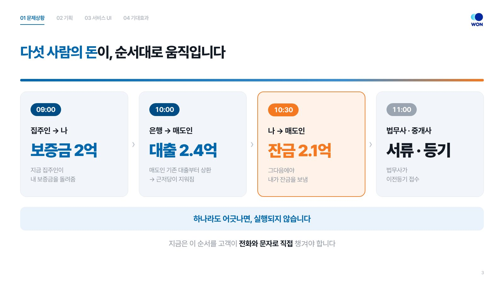</td><td></td></tr></tbody></table>

대본 (A · 0:40)

잔금일에는 다섯 사람의 돈과 서류가 하루 안에 맞물려 움직입니다. 거래마다 순서는 조금씩 다르지만, 이 고객의 경우를 보겠습니다. 9시, 지금 집주인이 보증금 2억을 돌려줍니다. 10시, 은행이 대출 2억 4천을 실행해 매도인의 기존 대출부터 갚습니다. 그래야 근저당이 지워집니다. 이 돈이 모여야 제가 잔금 2억 1천을 보내고, 법무사가 이전등기를 접수합니다. 하나라도 어긋나면 실행되지 않습니다. 그런데 지금은 이 모든 확인을 고객 혼자, 전화와 문자로 챙깁니다.

---

### 수정 2 · 4장 근거 교체: 왜 고객에게 필요한가

**왜 바꾸나.** 전세사기 피해 4만 1,559건은 임차인(전세)의 문제라 매매 서비스의 필요성과 바로 이어지지 않고, "전세 서비스인가?"라는 혼동을 만듭니다. 옆 카드의 "서울 아파트 계약 해제 +23%"도 시장 상황을 보여 줄 뿐, 고객이 이 서비스를 원하는 이유를 말하지는 않습니다.

**논리.** 제안하신 생각을 네 단계로 세웠습니다.

1. 잘못되면 큰일이다 (부담)
2. 그런데 누구에게나 처음이다 (경험 없음)
3. 그래서 혼자 챙기기보다 AI·앱의 도움을 원한다 (수요)
4. 이미 거래를 맡기는 데 돈을 쓰고 있으니, 약간의 이용료도 낼 만하다 (지불 의향)

**새 구성**

- 제목: 실수하면 큰일이라, 고객은 **믿고 맡길 도움**을 원합니다
- 카드 ① 부담 · **5,000만 원**: 잔금을 못 치르면 잃을 수 있는 계약금 (매매가 5억·계약금 10% 예시). 카드 아래에 실제 사례 인용: "금융기관 8곳을 돌았지만 잔금을 채우지 못해 계약금 5,000만 원을 잃었다" (경북매일 2026.7.22, 신혼부부 **분양 계약** 사례)
- 카드 ② 처음 · **11.5년**: 자가 가구가 한 집에 사는 평균 기간. 집을 사는 일은 10년에 한 번이라는 뜻입니다. 보조 수치로 생애 첫 집 마련까지 평균 7.9년 (국토교통부 2024년도 주거실태조사, 2025.11 발표)
- 카드 ③ 도움 · **67%**: 금융상품 가입 경험자 중 "복잡한 금융 업무에 AI 에이전트를 쓰겠다"는 응답 (CJ메조미디어 2026 업종 분석 리포트, 서울·경기·5대 광역시 약 1,000명, 파이낸셜뉴스 2026.10.1)
- 하단 바: 이미 중개·법무 비용 **약 270만 원**을 내는 고객이라면, **약간의 이용료**도 아깝지 않은 도움입니다 (270만 원 = 중개보수 200만 + 등기·법무 약 70만, 덱의 5억 매매 예시)

**지불 의향을 말할 때 주의할 점.** "이용료를 내겠다"를 직접 물은 조사는 찾지 못했습니다. 그래서 화면은 이미 내고 있는 비용(중개·법무 비용)과 이용 의향(67%)으로 받치고, 대본은 "~라고 봤습니다"로 말합니다. 또 수수료를 너무 앞세우면 5장의 '고객 유치' 논리와 부딪힐 수 있습니다. 질문이 나오면 "유료로도 쓸 만큼 가치가 있지만, 우리은행 대출·주거래 고객에게는 무료로 제공해 유치 수단으로 쓴다"는 구조로 답하는 것을 추천합니다.

<table class="ba"><thead><tr><th>지금 (4장)</th><th>수정안 (4장)</th></tr></thead><tbody><tr><td>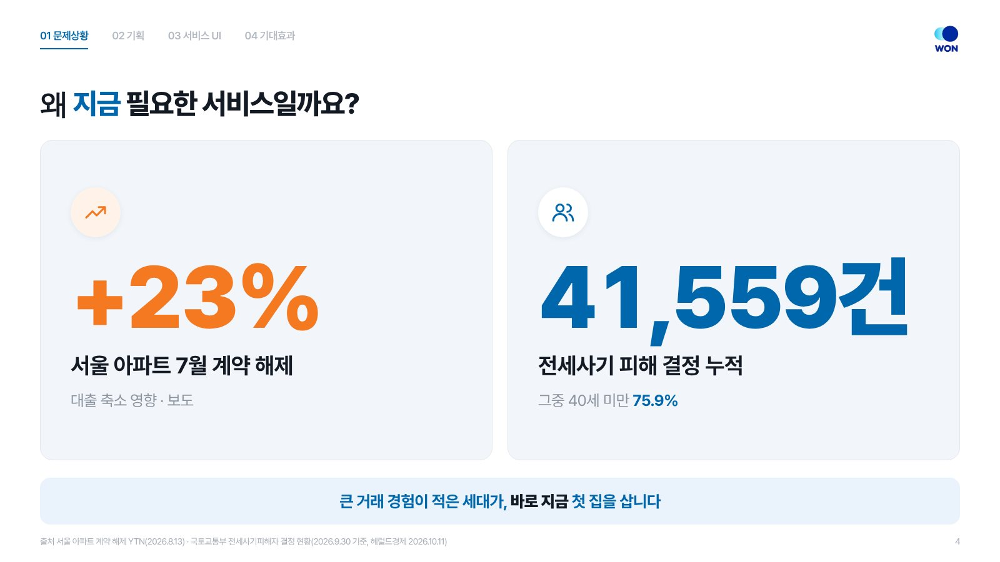</td><td></td></tr></tbody></table>

대본 (A · 0:45)

이게 왜 큰일일까요. 잔금을 치르지 못하면 계약금을 잃을 수 있습니다. 이 고객이라면 5,000만 원입니다. 실제로 올해 7월, 금융기관 여덟 곳을 돌고도 잔금을 채우지 못해 계약금 5,000만 원을 잃은 신혼부부 사례가 보도됐습니다. 그런데 자가 가구는 한 집에 평균 11.5년을 삽니다. 집을 사는 일은 10년에 한 번, 누구에게나 처음입니다. 그래서 고객은 믿고 맡길 도움을 원합니다. 복잡한 금융 업무라면 AI 에이전트를 쓰겠다는 응답이 67%입니다. 이미 중개·법무 비용으로 270만 원가량을 내는 고객이라면, 잔금일까지 챙겨 주는 도움에 약간의 이용료를 내서라도 쓸 것이라고 봤습니다.

---

### 수정 3 · 신규 5장: 은행에게 주는 이익

**한 줄 메시지.** 은행에게 첫 집은, 주거래가 바뀌는 **드문 순간**입니다.

**흐름 (왼쪽 → 오른쪽).** 요청하신 순서(고객 유치 → 장기 고객화 → 주거래 전환 기회 → 수익성)를 네 칸으로 옮겼습니다. 제목의 '드문 순간'을 받치는 2단계는 파란 칸으로 강조합니다.

| 단계 | 큰 숫자 | 뜻 | 근거 |
|---|---|---|---|
| 1 유치 | 38% | 2025년 서울 집합건물 매수자 중 생애 첫 구매자 (16만 927건 중 6만 1,159건, 2014년 이후 최고 비중) | 대법원 등기정보광장, 한경BUSINESS 2026.1.19 |
|  |  | 우리은행은 주택도시기금 간사수탁은행(2008년부터 4회 연속, 현재 2023.4~2028.3). 디딤돌 창구에서 이미 만나는 고객 | 비즈워치 2023.2.17 |
| 2 전환 | 15% | 이사할 때도 은행 계좌를 옮기는 사람. 옮긴 주담대 고객의 41%는 더 나은 대출 금리 때문 | Pay.UK CASS, 최근 2년 안에 이사한 영국 성인 2,000명, FF News 2026.9.7 |
| 3 정착 | 11.5년 | 산 집에 머무는 평균 기간. 그동안 대출·관리비·공과금 자동이체가 한 은행에 묶임 | 국토교통부 2024년도 주거실태조사 |
| 4 수익 | 4.5억 | 이 고객 한 명과 함께 움직이는 돈 (대출 2.4억 + 잔금 예치 2.1억) | 덱의 예시 |

하단 바: 이 순간을 잡으면, **대출 · 예치금 · 자동이체**가 10년 넘게 이어집니다.

**"고객은 한 은행에 정착한다"의 근거** (대본·Q&A용)

- 영국 CASS (2026): 이사라는 큰 변화가 있어도 은행 계좌를 옮긴 사람은 15%였고, 58%는 은행 변경을 검토조차 하지 않았습니다.
- 영국 경쟁시장청 CMA (2016): 개인 고객의 연간 은행 변경률은 약 3%. 중간 보고서 기준 57%가 10년 이상 같은 은행을 썼습니다(2014년 데이터).
- 하나금융경영연구소 (서울시민 500명, 2015): 주거래은행을 실제로 바꾼 사람 17.8%, 바꾸고 싶었지만 못 바꾼 사람 33.4%. 오래된 자료라 화면에는 쓰지 않고 Q&A에서만 씁니다.
- 국내 은행들이 주담대 우대금리 조건에 급여이체·카드·자동이체를 묶는 것도 주담대가 주거래를 바꾸는 지렛대라는 방증입니다.
- 같은 11.5년을 4장과 5장에서 다른 뜻으로 쓰면 기억에 남습니다. 고객에게는 '연습할 기회가 없다', 은행에게는 '그만큼 오래 함께할 고객'.

**수익성 질문 대비.** 예시 고객의 대출은 디딤돌(주택도시기금)이라 은행의 몫은 이자 마진보다 수탁 수수료에 가깝습니다. 은행 수익은 관계에서 나온다고 답하세요. 잔금 예치(안심금고), 급여·관리비 자동이체, 카드·적금, 이후 갈아타기나 다음 집 대출입니다. 자체 주담대를 쓰는 고객이면 이자 수익도 직접 생깁니다.

<table class="ba one"><thead><tr><th>신규 (5장)</th></tr></thead><tbody><tr><td></td></tr></tbody></table>

대본 (A · 0:45)

은행에게는 어떤 기회일까요. 작년 서울에서 집합건물을 산 사람 열 명 중 네 명이 생애 첫 구매자였습니다. 우리은행은 이들이 찾는 디딤돌 대출의 간사수탁은행입니다. 고객은 주거래 은행을 잘 바꾸지 않습니다. 영국 조사에서 이사할 때조차 은행을 바꾼 사람은 15%였고, 은행을 옮긴 주담대 고객의 41%는 대출 조건 때문이었습니다. 집을 사는 순간이 주거래가 바뀌는 드문 기회입니다. 한번 산 집에는 평균 11.5년을 삽니다. 그동안 대출과 자동이체가 한 은행에 이어지고, 이 고객 한 명과 함께 움직이는 돈만 4억 5천만 원입니다. 이 순간을 어떻게 잡을지, B가 이어가겠습니다.

---

### 수정 4 · 5장(→6) 'KB부동산 전세안심 Check' → 'K사'

| 위치 | 지금 | 수정안 |
|---|---|---|
| 비교표 2행 | KB부동산 전세안심 Check | K사 부동산 서비스 |
| 하단 각주 | … · KB부동산 전세안심 Check 2026.8.28 | … · K사: 타 금융사 부동산 플랫폼의 단계별 체크리스트 서비스 |
| 대본 | KB 전세안심 Check는 점검과 단계별 안내까지 합니다 | K사 부동산 서비스는 점검과 단계별 안내까지 합니다 |

- 출시일(2026.8.28)까지 쓰면 어느 회사인지 특정되므로 각주에서 날짜를 뺐습니다.
- 저장소 `docs/예상질문_QA.md`의 Q1 각주에도 같은 이름이 있습니다. 발표장에서 Q&A 자료를 띄운다면 함께 바꾸세요.

<table class="ba"><thead><tr><th>지금 (5장)</th><th>수정안 (6장)</th></tr></thead><tbody><tr><td>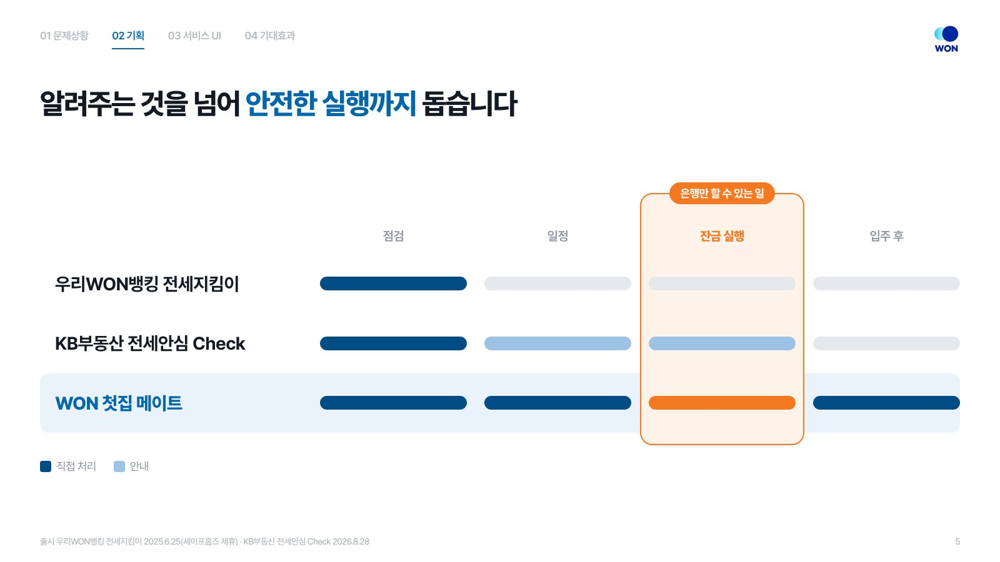</td><td></td></tr></tbody></table>

---

### 수정 5 · AI 에이전트가 정확히 하는 일

**진단.** 지금 덱은 AI가 하지 않는 일(돈을 직접 움직이지 않음)은 분명하지만, 하는 일은 "이해 · 계획 · 설명", "AI가 쪼개기"처럼 추상적입니다. 심사위원에게는 "체크리스트 앱이나 챗봇과 무엇이 다른가?"(예상질문 Q2)라는 의문이 남습니다.

**아이디어 6가지** (시안에는 A~D 반영)

**A. 전용 슬라이드 (13장, 수정 8과 연결).** 제목은 "챙기는 일은 AI 에이전트가, 고객은 확인하고 승인합니다", 부제는 "챗봇은 묻는 말에 답하고, 에이전트는 먼저 챙깁니다". 동사 5개를 고객 여정 순서로 놓고, 칸마다 시점, AI가 하는 일, 불러 쓰는 은행 기능, '혼자라면'을 씁니다. 은행 기능을 적어 두면 AI가 막연히 똑똑한 것이 아니라 은행 시스템을 도구로 쓴다는 점이 드러납니다.

| 동사 | 시점 | AI가 하는 일 | 불러 쓰는 은행 기능 | 혼자라면 |
|---|---|---|---|---|
| 읽고 | 계약 직후 | 계약서 사진에서 금액·날짜를 뽑고, 등기부 내용을 쉬운 말로 요약 | 문서 인식, 등기부 조회 | 서류를 보며 숫자를 옮겨 적기 |
| 계획하고 | D-56 | 고객 상황에 맞춰 잔금일부터 거꾸로 할 일 11개, 일요일 잔금일은 조정 제안 | 영업일 달력, 대출 일정, 알림 | 달력에 적고, 놓친 일은 뒤늦게 알기 |
| 찾아내고 | D-14 | 빠지기 쉬운 비용을 챙겨 계산을 맡기고, 모자란 돈과 채울 방법을 2주 전에 알림 | 계좌·대출 조회, 규칙 엔진 계산 | 잔금일에야 부족한 돈을 발견 |
| 지켜보고 | D-day | 은행 시스템이 확인하는 5개 조건을 지켜보며, 진행 상황과 다음 할 일을 쉬운 말로 알림 | 조건 확인 결과, 알림 | 집주인·은행·법무사에 전화 돌리기 |
| 대신 준비합니다 | 어긋날 때·입주 후 | 멈춘 이유 설명, 문자 초안·상담 연결, 마감 알림 | 문자 초안, 상담 연결, 자동이체 제안 | 문제가 생기면 혼자 수습 |

**13장이 AI 에이전트의 일만 담았는지 점검한 결과.** 처음 시안에는 덱 안의 역할 분담과 어긋나는 칸이 두 개 있어 고쳤습니다. 기준은 8장(금액 계산·조건 확인·이체 예약은 규칙 엔진), 11장(조건마다 자동·은행·사람 확인), 예상질문 Q5("AI가 판단하지 않습니다")입니다.

| 칸 | 판정 | 이유와 조치 |
|---|---|---|
| 읽고 | 맞음 | 비정형 문서(계약서 사진)를 이해하고 요약하는 일은 AI가 잘하는 일입니다. 등기부 조회 자체는 API이고, AI는 그 결과를 쉬운 말로 풀어 줍니다. 위험 여부의 최종 판단은 전문가 몫입니다 |
| 계획하고 | 맞음 | 목표(이사일)를 받아 고객 상황에 맞는 할 일을 고르고 일정을 짜는 일은 에이전트의 핵심 기능입니다. 영업일 판정은 달력 규칙이지만, 조정을 먼저 제안하고 중개사 문자를 써 주는 것은 AI입니다 |
| 계산하고 → 찾아내고 | 고침 | 금액 계산은 8장에서 규칙 엔진의 일로 정했습니다. AI의 몫은 빠지기 쉬운 비용 항목을 챙겨 계산을 맡기고, 결과를 설명하고, 채울 방법을 제안하는 일입니다 |
| 지켜보고 | 고침 | "5개 조건을 확인해 송금 준비"는 AI가 조건을 판단하는 것처럼 읽혔습니다. 조건 확인과 송금 잠금은 은행 시스템이 하고, AI는 진행 상황을 지켜보며 쉬운 말로 알리고 다음 할 일을 안내합니다 |
| 대신 준비합니다 | 대체로 맞음 | 이유 설명과 문자 초안은 AI의 생성 능력, 상담 연결은 도구 호출입니다. 다만 '자동이체'는 AI가 직접 등록하는 것처럼 보여 '자동이체 제안'으로 바꿨습니다. 등록은 고객 승인 뒤 은행 시스템이 합니다 |

같은 이유로 하단 바를 "계산·조건 확인은 은행 시스템이, 최종 승인은 고객이 · AI는 돈을 직접 움직이지 않습니다"로, 제목의 "고객은 확인과 승인만"을 "고객은 확인하고 승인합니다"로 바꿨습니다. 고객은 이체한도 추가약정, 부족분 채우기 선택처럼 직접 하는 일도 있어서 '만'은 과장이었습니다. 10장 대본의 "AI가 따로 드는 돈까지 계산해 보니"도 "AI가 빠지기 쉬운 따로 드는 돈을 챙겨 넣으면"으로 고쳤습니다.

**심사에서 "그건 그냥 자동화 아닌가요?"라고 물으면.** 일정 계산, 조건 확인, 알림은 규칙으로도 됩니다. AI 에이전트가 꼭 필요한 부분은 네 가지입니다. 계약서 같은 비정형 문서 이해, 대화로 받은 상황에 맞춘 개인별 계획, 어려운 용어와 진행 상황을 쉬운 말로 설명하기, 어긋났을 때 계획을 다시 짜고 문자 초안을 쓰는 예외 대응입니다. 에이전트는 이런 판단을 맡고, 정확해야 하는 계산·확인·이체는 검증된 은행 시스템을 도구로 불러 씁니다.

**B. 역할을 한 문장으로 고정.** "AI는 챙기고, 실행은 은행 기능이, 승인은 고객이 합니다." 7장 하단 바에 넣고, 8장(세 층 구조)과 13장 하단에서 같은 뜻을 반복합니다.

**C. 8장 AI 칸을 동사로.** "이해 · 계획 · 설명" → "계약서 읽기 · 할 일 계획 · 쉬운 설명".

**D. 화면 슬라이드 설명을 'AI가 한 일'로.** 9장 "계약서를 읽고 / 일요일 잔금일을 먼저 발견 / 놓치기 쉬운 일까지 D-14에", 10장 "AI가 잔금 지도에서 찾아낸 돈".

**E. "왜 에이전트인가"에 대한 답 (Q&A).** 목표(이사일)를 받아 스스로 계획한다 → 은행 기능을 도구로 불러 쓴다 → 상태를 지켜보다 먼저 알린다 → 어긋나면 계획을 다시 짠다 → 돈이 나가는 순간에는 사람의 승인을 받는다.

**F. 우리은행 방향과 연결 (12장 대본).** 우리은행은 삼성SDS와 AI 에이전트 175개 이상을 구축 중이고(12월 1차 97개 공개 계획), 우리WON뱅킹 챗봇과 AI뱅커 통합 고도화도 계획하고 있습니다. 첫집 메이트를 "그 플랫폼 위에 올라가는 고객용 에이전트"로 설명하면 은행의 전략과 맞닿습니다.

<table class="ba"><thead><tr><th>지금 (7장 세 층 구조)</th><th>수정안 (8장, AI 칸 문구)</th></tr></thead><tbody><tr><td>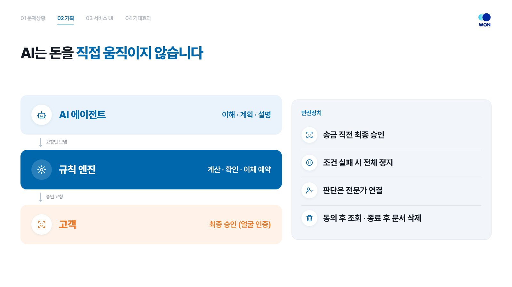</td><td></td></tr></tbody></table>

<table class="ba"><thead><tr><th>지금 (6장 네 단계)</th><th>수정안 (7장, 제목·하단 문장)</th></tr></thead><tbody><tr><td>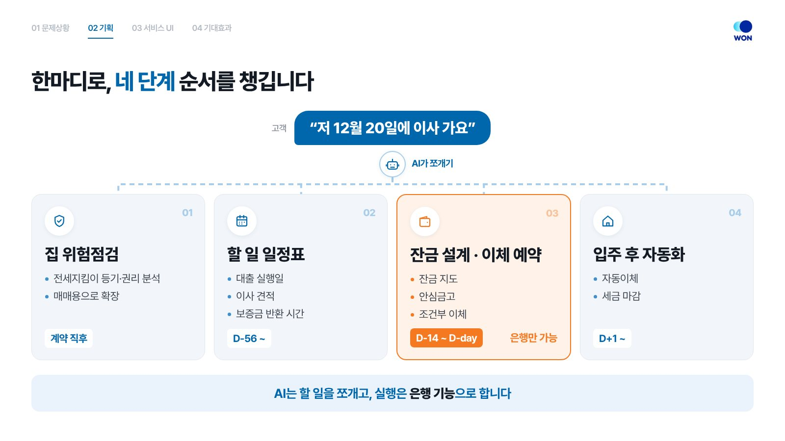</td><td></td></tr></tbody></table>

---

### 수정 6 · 폰 목업 확대 (10장 제외)

**진단.** 기존 8장 폰은 높이 560px, 9장은 580px라 폰 속 글자가 슬라이드 기준 약 9~10px입니다. 1080p 화면에 띄워도 11~12px 정도라 심사석에서는 읽기 어렵습니다. 13장 폰(440px)도 작습니다.

**원칙**

1. **해상도 한계부터 확인.** 폰 이미지 원본이 520×1032px라, 슬라이드에서 높이 약 860px까지는 1080p 화면에서 1:1로 선명합니다. 그보다 크게 쓰거나 일부만 확대하려면 폰 화면을 2배 해상도로 다시 내보내세요.
2. **아래로 흘려 자르기.** 폰 아래쪽(홈 바, 빈 여백)은 잘려도 됩니다. 정보가 있는 위쪽 85~90%만 보이게 두면 폰을 훨씬 크게 쓸 수 있습니다.
3. **폰 1~2대와 짧은 설명.** 설명 카드의 배경·테두리는 강조할 한 장에만 줍니다.
4. **'컨셉 화면' 캡션은 하단 각주로.** 폰 아래가 잘리므로 오른쪽 아래 각주로 옮깁니다.

| 장 | 지금 | 수정안 | 코드 |
|---|---|---|---|
| 1 표지 | 720px | 860px, 캡션은 폰 왼쪽 아래 | `.cover .phone{height}` |
| 9 (구 8) | 560px × 2 | 800px × 2, 아래로 흘림 | `.ph2 .phone` → `.ui .phone.big{height:800px}` |
| 10 (구 9) | 580px | 800px, 부족 알림 위치에 주황 테두리 | `.ring` 추가 |
| 14 (구 13) | 440px | 600px | `.close .r .phone{height}` |

9·10장 비교는 수정 7에 있습니다.

<table class="ba"><thead><tr><th>지금 (1장)</th><th>수정안 (1장)</th></tr></thead><tbody><tr><td>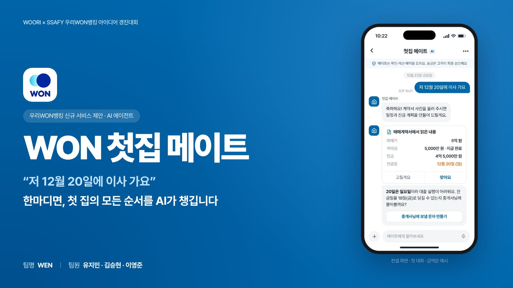</td><td></td></tr></tbody></table>

<table class="ba"><thead><tr><th>지금 (13장)</th><th>수정안 (14장)</th></tr></thead><tbody><tr><td>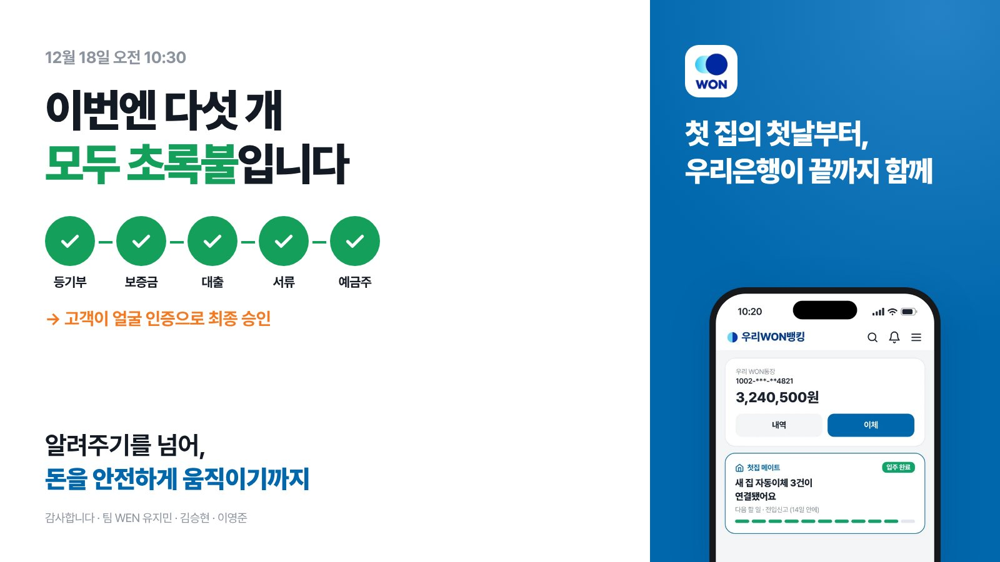</td><td></td></tr></tbody></table>

---

### 수정 7 · 8·9장(→9·10) 재구성: 한 장에 강조 한 곳

**기존 8장 진단.** 폰 두 대, 번호 세 개, 무게가 같은 큰 카드 세 장이 한꺼번에 보여서 시선이 폰과 카드 사이를 오갑니다. 제목은 'D-56 일정표'인데 첫 폰은 계약서 화면입니다.

**기존 9장 진단.** 강조가 세 곳입니다. 가장 진한 파란 칸 '잔금 4.5억'이 정작 핵심인 주황 '620만 원 부족'과 경쟁하고, 초록 '전세대출 상환 없음' 줄이 세 번째 색으로 시선을 나눕니다. 오른쪽 수식은 폰 화면과 같은 정보를 반복합니다.

**새 9장 (B · 0:50)**

- 제목: 계약서 한 장이면, 잔금일까지 **할 일 11개**가 정리됩니다 (폰 화면의 "할 일 11개 중 3개 끝났어요"와 같은 숫자)
- 폰 두 대를 크게 두고, 사이에 `›`로 '계약서 → 일정표' 흐름 표시
- 설명은 'AI가 한 일' 세 줄: ① 계약서를 읽고, 고객은 '맞아요'만 ② 일요일 잔금일을 먼저 발견 ③ 놓치기 쉬운 일까지 D-14에 (이체한도 추가약정). **③만 주황**으로 강조
- 마지막 줄: 고객은 할 일 11개를 기억하지 않아도 됩니다
- 시선: 폰 번호 1·2 → 주황 3 → 오른쪽 설명 3

**새 10장 (C · 0:45)**

- 제목: 2주 전에, **모자란 620만 원**을 먼저 알려 줍니다
- 큰 숫자는 **620만 원 하나만** (주황). 폰의 부족 알림 칸에 주황 테두리
- 비용 세 칸: 취득세 약 350만 · 중개보수 200만 · 등기·법무 약 70만
- '잔금 4.5억 확보' 수식은 회색 한 줄로 낮춥니다. 초록 '전세대출 상환 없음' 줄은 삭제합니다(폰 화면과 대본에 남아 있음)
- 시선: 620만 원 → 폰 주황 테두리 → 비용 세 칸

<table class="ba"><thead><tr><th>지금 (8장)</th><th>수정안 (9장)</th></tr></thead><tbody><tr><td>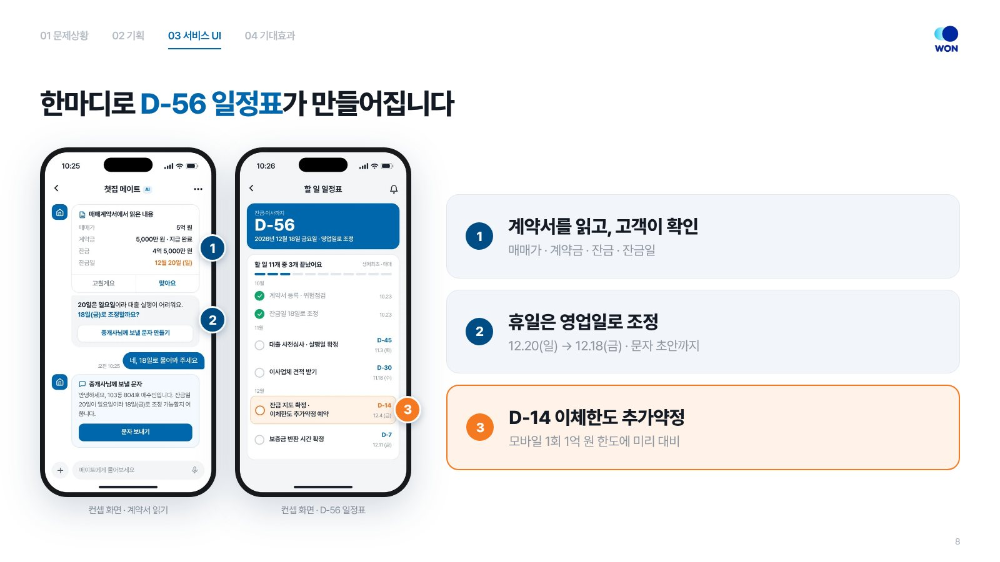</td><td></td></tr></tbody></table>

<table class="ba"><thead><tr><th>지금 (9장)</th><th>수정안 (10장)</th></tr></thead><tbody><tr><td>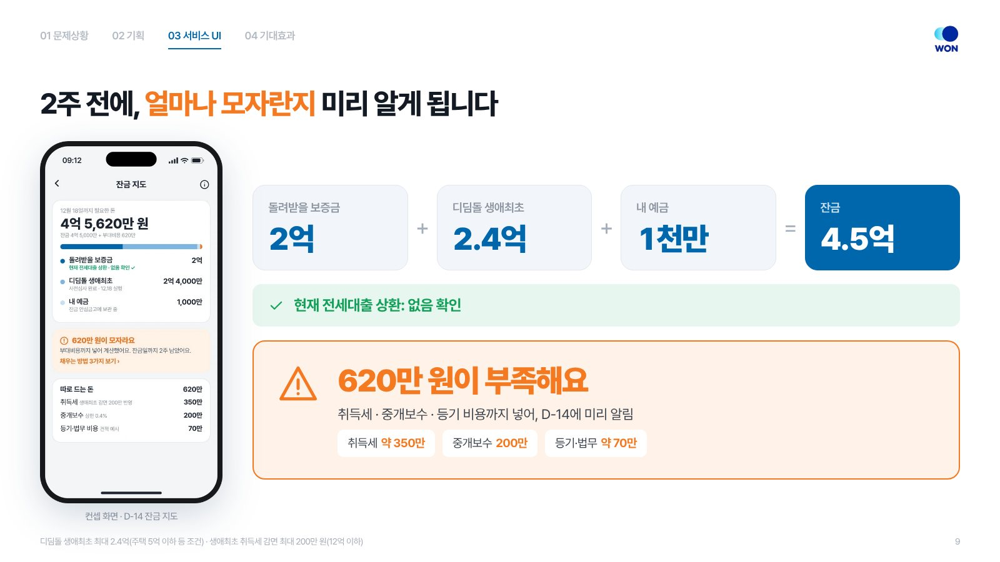</td><td></td></tr></tbody></table>

대본 (9장 B · 0:50 / 10장 C · 0:45)

**9장.** 이제 화면입니다. 계약서를 올리면 AI가 매매가와 잔금, 잔금일을 읽고, 고객은 '맞아요'만 누릅니다. 20일은 일요일이라 대출 실행이 어렵습니다. 그래서 18일 금요일로 조정할지 먼저 묻고, 중개사님께 보낼 문자도 써 줍니다. 그렇게 잔금일까지 할 일 11개가 일정표로 정리됩니다. 특히 놓치기 쉬운 이체한도 추가약정을 D-14에 넣었습니다. 모바일은 보안 1등급도 1회 1억 원까지라, 2억 1천은 미리 준비해야 합니다. 고객은 할 일을 외우지 않아도 됩니다. 다음 화면은 C가 보여 드리겠습니다.

**10장.** D-14, 잔금 지도입니다. 금액은 모두 예시입니다. 보증금 2억, 디딤돌 2억 4천, 내 예금 1천으로 잔금 4억 5천은 맞습니다. 그런데 AI가 빠지기 쉬운 따로 드는 돈을 챙겨 넣으면, 취득세 약 350만, 중개보수 200만, 등기·법무 비용 약 70만. 합쳐서 620만 원이 모자랍니다. 잔금일 당일이 아니라 2주 전에 알려 주고, 채우는 방법까지 이어서 보여 줍니다.

---

### 수정 8 · 12장 삭제 → AI 에이전트 슬라이드로 대체

- '고객 / 은행 / 사회' 카드와 '시범 운영에서 측정' 지표를 지웁니다. 은행 내용은 새 5장이, 고객 내용은 4장과 13장이 맡습니다. '사회(청년 주거 금융 사고 예방)'는 클로징 대본 한 줄이면 충분합니다.
- 측정 지표 4개(잔금일 정상 완료율, 위험 조기 경고 건수, 첫집 고객 주거래 전환율, 안심금고 평균 잔액)는 버리지 말고 Q&A 답변으로 옮기세요. 4장의 지불 의향을 검증할 '유료 이용 의향'도 함께 묶으면 좋습니다.
- 자리는 요청대로 기존 12번 자리(12장 '기존 서비스 위에' 다음, 클로징 앞)입니다. 12장 대본 끝에 "그렇다면 이 에이전트가 고객을 위해 하는 일은 무엇일까요"를 넣어 이어 줍니다. 시연(11장) 바로 뒤로 옮겨 '방금 본 화면 정리'로 쓰는 방법도 있습니다.

<table class="ba"><thead><tr><th>지금 (12장)</th><th>수정안 (13장)</th></tr></thead><tbody><tr><td>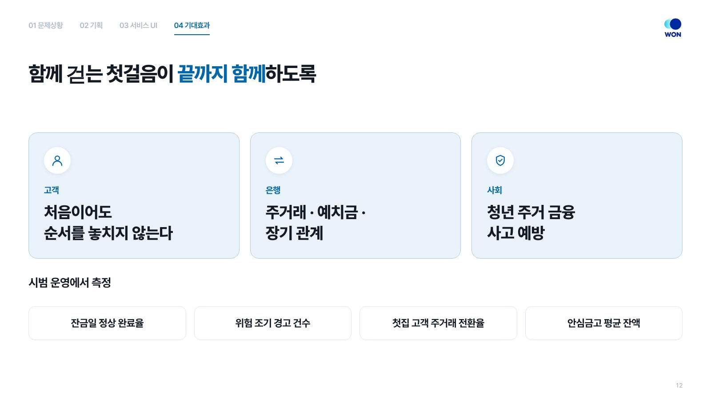</td><td></td></tr></tbody></table>

대본 (13장 C · 0:45)

그렇다면 AI 에이전트는 정확히 무슨 일을 할까요. 챗봇은 묻는 말에 답하지만, 에이전트는 먼저 챙깁니다. 계약서를 읽고, 고객 상황에 맞춰 할 일을 계획하고, 빠지기 쉬운 비용을 찾아내고, 잔금일에는 은행 시스템이 확인하는 다섯 조건을 지켜보며 쉬운 말로 알리고, 어긋나면 문자 초안과 상담 연결까지 대신 준비합니다. 금액 계산과 조건 확인은 은행 시스템이, 최종 승인은 고객이 합니다. 지금은 고객이 서류와 달력, 전화로 혼자 하는 일들입니다. 이제 고객이 하는 일은 확인과 최종 승인뿐입니다. 마무리는 A가 하겠습니다.

---

### 수정 9 · 덱 전체: 부담을 AI와 함께 덜어 준다

네 가지 감정(부담·복잡·지침·정신없음)을 한 장에 몰지 않고 장마다 하나씩 깔았습니다. 톤은 "없애 준다"보다 "덜어 준다, 함께 챙긴다"로 맞췄습니다. 은행 실무자 앞에서는 과장이 가장 큰 감점 요인이기 때문입니다.

| 장 | 감정 | 문구 |
|---|---|---|
| 1 | 복잡 | 한마디면, 복잡한 첫 집 준비를 AI가 함께 챙깁니다 |
| 2 | 부담·정신없음 | (부제) 인생에서 가장 큰 송금 버튼 앞에서, 손가락이 멈춥니다 |
| 3 | 지침 | 지금은 이 모든 확인을 고객 혼자, 전화와 문자로 챙깁니다 |
| 4 | 부담 | 카드 라벨 '부담 · 처음 · 도움', 제목 "실수하면 큰일이라…" |
| 7 | 역할 | AI는 챙기고, 실행은 은행 기능이, 승인은 고객이 합니다 |
| 9 | 복잡 | 고객은 할 일 11개를 기억하지 않아도 됩니다 |
| 10 | 정신없음 예방 | 잔금일 당일이 아니라 2주 전에, 채우는 방법까지 안내 |
| 13 | 전체 요약 | '혼자라면' 줄로 AI가 덜어 준 일을 한눈에 |
| 14 | 마무리 | 복잡한 첫 집, 이제 혼자 챙기지 않아도 됩니다 |

<table class="ba"><thead><tr><th>지금 (2장)</th><th>수정안 (2장, 부제)</th></tr></thead><tbody><tr><td>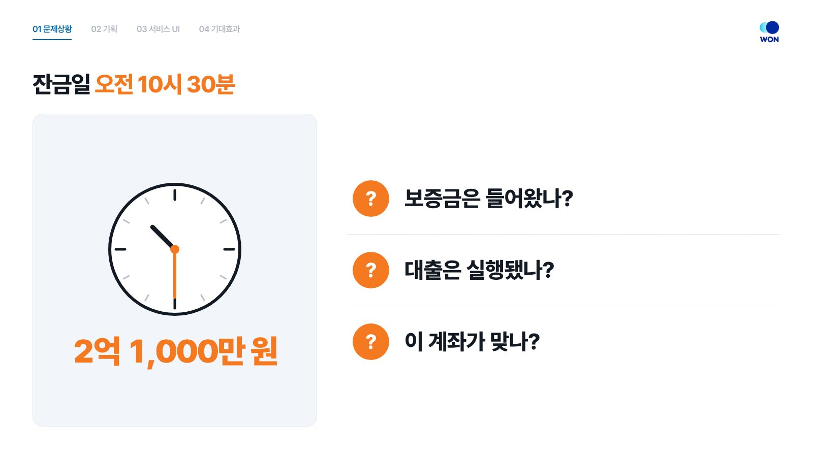</td><td></td></tr></tbody></table>

대본 (14장 A · 0:25)

처음 장면으로 돌아가겠습니다. 12월 18일 오전 10시 30분. 이번엔 다섯 개 모두 초록불입니다. 저는 얼굴 인증으로 최종 승인만 합니다. 복잡하고 부담스러운 첫 집, 이제 혼자 챙기지 않아도 됩니다. 알려주기를 넘어 돈을 안전하게 움직이기까지, 첫 집의 첫날부터 우리은행이 끝까지 함께하겠습니다. 감사합니다.

---

## 3. 근거 자료 목록

| 쓰는 곳 | 수치 | 출처 | 확인 내용·주의 |
|---|---|---|---|
| 4장 | 자가 11.5년 · 임차 3.6년 · 전체 8.4년 · 생애최초 7.9년 | 국토교통부 2024년도 주거실태조사(2025.11.16 발표), [뉴데일리](https://biz.newdaily.co.kr/site/data/html/2025/11/15/2025111500090.html) | 원문 문장 확인 |
| 4장 | 67% | CJ메조미디어 2026 업종 분석 리포트, [파이낸셜뉴스 2026.10.1](https://www.fnnews.com/news/202610011112457473) | 전체 표본 약 1,000명(서울·경기·5대 광역시). 67%는 금융상품 가입 경험자 기준이며 하위 표본 수와 조사 기간은 기사에 없음 |
| 4장 | 금융기관 8곳 · 계약금 5,000만 원 | [경북매일 2026.7.22](https://kbmaeil.com/article/20260721500144) | 대구 수성구 **분양 계약** 사례. 매매 사례가 꼭 필요하면 교체 |
| 5장 | 38% (6만 1,159 / 16만 927건) | 대법원 등기정보광장, [한경BUSINESS 2026.1.19](https://magazine.hankyung.com/business/article/202601199662b) | 2025년, 서울, 집합건물 매매 이전등기. 2014년 이후 최고 비중 |
| 5장 | 15% · 41% | Pay.UK CASS, [FF News 2026.9.7](https://ffnews.com/news/two-in-five-mortgage-holders-who-switched-banks-did-so-for-a-better-mo-b82cd689) | 최근 2년 안에 이사한 영국 성인 2,000명. 41%의 기준은 '이사하며 은행을 옮긴 주담대 보유자' |
| 5장 | 간사수탁은행 4회 연속 | [비즈워치 2023.2.17](https://news.bizwatch.co.kr/article/real_estate/2023/02/17/0004) | 2023.4~2028.3 수행 |
| Q&A | 연간 은행 변경 3% · 10년 이상 57% | 영국 CMA 소매금융 시장조사(2016), [gov.uk](https://www.gov.uk/government/news/bank-switching-to-be-overhauled) | 57%는 중간 보고서(2014년 데이터) 수치 |
| Q&A | 실제 변경 17.8% · 못 바꿈 33.4% | 하나금융경영연구소, [디지털타임스 2015.4.28](https://www.dt.co.kr/article/10938166) | 2015년 자료라 화면에는 쓰지 않음 |
| 12·13장 대본 | AI 에이전트 175개 이상 · 12월 1차 97개 | [헤럴드경제 2026.4.6](https://www.heraldk.com/article/2026040615250644763), [비즈워치 2026.4.7](https://news.bizwatch.co.kr/article/mobile/2026/04/07/0002) | 출시 일정 표현은 매체마다 조금 다름 |
| 참고 | 2030 비중 약 69% | [헤럴드경제 2026.8.17](https://www.heraldk.com/article/2026081717134483063) | 제목에만 있는 수치. 본문은 2026년 7월 서울 생애최초 매수자 중 20대 11.8% + 30대 57.0%. 쓰려면 이렇게 정확히 |

---

## 4. 추가로 발견한 점

1. **11장(구 10) 조건 순서.** 실무에서는 법무사가 매도인 서류를 확인한 뒤 대출이 실행되는 경우가 많은데, 화면은 10:00 대출 실행 → 10:15 법무사 확인 순입니다. 장면 이미지 14장을 다시 만드는 대신 각주를 달았습니다. 질문이 나오면 "확인되는 순서는 거래마다 다르고, 다섯 조건이 모두 충족돼야 송금이 열린다는 원칙은 같다"고 답하세요. 팀 멘토나 실무 자료로 한 번 확인해 보길 권합니다.
2. **'디딤돌 사전심사' 표현.** 저장소 README는 "공식 용어가 아닐 수 있어 바꿨다"고 적었지만, HTML에는 12장(구 11)의 '디딤돌 · 사전심사'와 폰 이미지(일정표 "대출 사전심사 · 실행일 확정", 잔금 지도 "사전심사 완료")에 그대로 남아 있습니다. 텍스트는 바로 고칠 수 있고, 이미지는 다시 내보낼 때 고치세요.
3. **페이지 번호.** 기존 2·6·7장에는 번호가 없었습니다. Q&A에서 "몇 페이지"로 짚을 수 있도록 시안에서는 모든 본문 장에 번호를 넣었습니다.
4. **저장소 문서와 HTML 덱이 다름.** README·스토리보드·예상질문은 이전 PPTX(10장) 기준이라 장 번호와 내용이 지금 HTML 덱과 다릅니다. 최종본이 정해지면 함께 맞추세요.
5. **시간.** 장이 늘어 10분을 넘기기 쉽습니다. 시안 대본 기준으로 9:25가 되도록 다시 나눴으니 리허설로 확인하세요.

---

## 5. 새로 대비할 질문

**Q. 왜 영국 자료인가요?**
국내에는 이사 시점과 주거래 변경을 함께 추적한 공개 통계를 찾기 어려웠습니다. 그래서 계좌이동 제도를 운영하는 영국 Pay.UK 조사를 참고했습니다. 국내에서도 주거래은행을 실제로 바꾼 사람(17.8%)보다 바꾸고 싶었지만 못 바꾼 사람(33.4%)이 더 많았다는 조사가 있습니다. 국내 수치는 시범 운영에서 '첫집 고객 주거래 전환율'로 직접 재겠습니다.

**Q. 이용료를 받을 건가요?**
가치로 보면 유료로도 쓸 만하다고 봅니다. 고객은 이미 중개·법무 비용으로 수백만 원을 내고, 67%가 복잡한 금융 업무에 AI 에이전트를 쓰겠다고 답했습니다. 다만 은행의 목적은 고객 유치이므로, 우리은행 대출·주거래 고객에게는 무료로 제공하고 그 밖의 고객에게 소액 이용료를 받는 구조를 시범에서 검증하겠습니다.

**Q. 디딤돌은 기금 대출이라 은행 수익이 크지 않은데요?**
맞습니다. 디딤돌에서 은행이 얻는 것은 수탁 수수료 수준입니다. 저희가 보는 수익은 관계에서 나옵니다. 잔금 예치(안심금고), 급여·관리비 자동이체, 카드·적금, 이후 갈아타기나 다음 집 대출입니다. 자체 주담대를 쓰는 고객이면 이자 수익도 직접 생깁니다.

**Q. 챗봇이나 체크리스트 앱과 무엇이 다른가요?**
챗봇은 묻는 말에 답하고 끝나지만, 에이전트는 먼저 챙깁니다. 목표(이사일)를 받아 스스로 계획하고, 은행 기능(조회·계산·예약)을 불러 준비하고, 상태를 지켜보다 먼저 알리고, 어긋나면 계획을 다시 짭니다. 돈이 나가는 순간에는 고객의 승인을 받습니다.

**Q. 거래마다 순서가 다르면 5개 조건도 달라지나요?**
조건의 목록은 같고, 확인되는 시점만 다릅니다. 다섯 조건이 모두 초록일 때만 송금이 열린다는 원칙은 그대로입니다.

---

## 6. 적용 체크리스트

- [ ] 3장 제목·라벨·아이콘·3번째 카드·하단 문장 (수정 1)
- [ ] 1·7·11장의 '순서' 표현과 11장 각주 (수정 1)
- [ ] 4장 전면 교체와 출처 표기 (수정 2)
- [ ] 5장 신규, 탭 이름 `01 문제와 기회` (수정 3)
- [ ] 6장 K사 표기·각주·대본, `docs/예상질문_QA.md` Q1 (수정 4)
- [ ] 7·8장 AI 역할 문구, 13장 신규 (수정 5·8)
- [ ] 1·9·10·14장 폰 크기 (수정 6)
- [ ] 9·10장 재구성 (수정 7)
- [ ] 12장 삭제, 측정 지표는 Q&A로 (수정 8)
- [ ] 장별 '부담을 덜어 준다' 문구 (수정 9)
- [ ] 모든 장 대본(`<aside class="notes">`) 갱신, 페이지 번호, 10분 리허설
